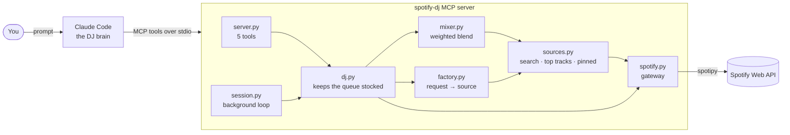

# spotify-dj

Talk to Claude like it's a DJ. An [MCP](https://modelcontextprotocol.io) server that lets Claude Code
build a Spotify mix from plain-English requests and keep the queue topped up while you listen.

> "Play Taylor Swift songs from 2015"
> "Add One Direction to the mix, but only upbeat ones"
> "More Taylor"
> "Play artists like The Script"
> "Play some Taylor Swift songs I might like"

<!-- TODO: add demo GIF here -->


## How it works



**Claude decides what to play; the server plays it.** Claude turns a request into a *mix* of sources
with weights. A background loop (every 5 s, or immediately when the mix changes) tops Spotify's queue up
to a small depth (default 3 songs including the current one), so a new request is heard within a song or two.

| Source | What it is | Example request |
|---|---|---|
| `search` | Spotify search by artist / album / genre / year. Endless. | "Taylor Swift from 2015" |
| `top_tracks` | Your own favourites, then more songs by those artists. | "songs I might like" |
| `pinned` | Specific songs Claude picks from its own knowledge. | "upbeat One Direction" |

Sources are blended by **weight** ("more Taylor"), never repeat a song until everything has played, and
anything Spotify can't do is **flagged** back to you rather than silently ignored.

## The LLM replaces Spotify's deprecated APIs

Spotify has been closing the doors a music-recommendation app would use. New apps can no longer call
recommendations, related artists or audio features (Nov 2024), and in Feb 2026 Development Mode lost
artist top tracks, cut search to 10 results per call, and now needs a Premium owner.

Instead of working around that, this project leans on the model:

- **"Artists like The Script"**: Claude names similar artists from its own knowledge; each becomes a search source.
- **"Upbeat"** (Spotify can't filter by mood): Claude picks specific songs, the server looks each one up.
- **Anything impossible**: the tool design has no `mood` field to misuse, and Claude is told to say what was approximated.

Spotify becomes a catalogue and a player; the taste lives in the model.

## Setup

Requires [uv](https://docs.astral.sh/uv/), Python 3.11+, Spotify **Premium** and
[Claude Code](https://claude.com/claude-code).

1. **Create a Spotify app** at the [developer dashboard](https://developer.spotify.com/dashboard),
   add the redirect URI `http://127.0.0.1:8888/callback` and enable the Web API.
   (Development Mode apps allow up to 5 users, which is plenty here.)
2. **Configure**: `cp .env.example .env` and set `SPOTIFY_CLIENT_ID`. No client secret is needed (PKCE login).
3. **Log in once**: `uv sync && uv run spotify-dj login` (opens your browser, saves `.spotify_token.json` here).
4. **Register with Claude Code** so it works from any folder:
   ```bash
   claude mcp add --scope user spotify-dj -- uv --directory /absolute/path/to/spotify-dj run spotify-dj
   ```
5. **Play something** in Spotify on any device (Spotify only accepts queued songs while a device is active),
   open Claude Code anywhere and ask for music.

Everything the server writes stays in this folder: `.env`, `.spotify_token.json` and `logs/` (all git-ignored).

### Settings (`.env`)

| Variable | Default | Meaning |
|---|---|---|
| `DJ_QUEUE_DEPTH` | `3` | Songs kept queued, including the one playing |
| `DJ_POLL_SECONDS` | `5` | How often playback is checked |

## Tests

```bash
uv run pytest            # unit tests, no network (fake Spotify)
uv run pytest -m live    # real Spotify; needs login + a playing device; queues real songs
```

## Reading the code

Under 900 lines in `src/spotify_dj/`. A good order:

1. `models.py`, `spotify.py`: the data and the only module that touches Spotify (`SpotifyGateway` is the seam).
2. `sources.py`: every music origin is a lazy stream behind one `Source` base class.
3. `mixer.py`: weighted round-robin blend with a no-repeat history.
4. `factory.py`: turns Claude's structured request into a source, rejecting what Spotify can't answer.
5. `dj.py`: `tick()` keeps the queue stocked by comparing what *we* queued with Spotify's real queue.
6. `session.py`, `server.py`, `cli.py`: the lock + loop, the MCP tools, and the wiring.

Design notes: dependencies point inward (the domain only knows the `SpotifyGateway` protocol, so tests
use an in-memory fake); new source types plug into the mixer without changing it; interfaces exist only
where something is actually swapped (Spotify ↔ fake, source ↔ source).

## Limitations

- Spotify's queue can only be appended to, so after "Play X" the 1–2 songs already queued still play first.
- The DJ only runs while Claude Code is running, and can't speak up on its own: ask `get_status` to see problems.
- Genre search is best-effort; Spotify's genre filter is patchy.
